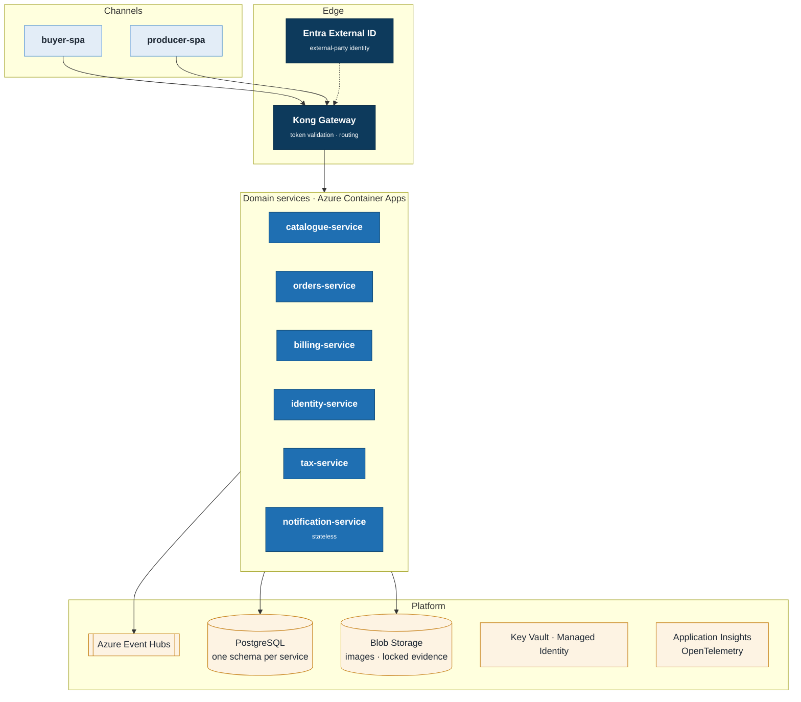
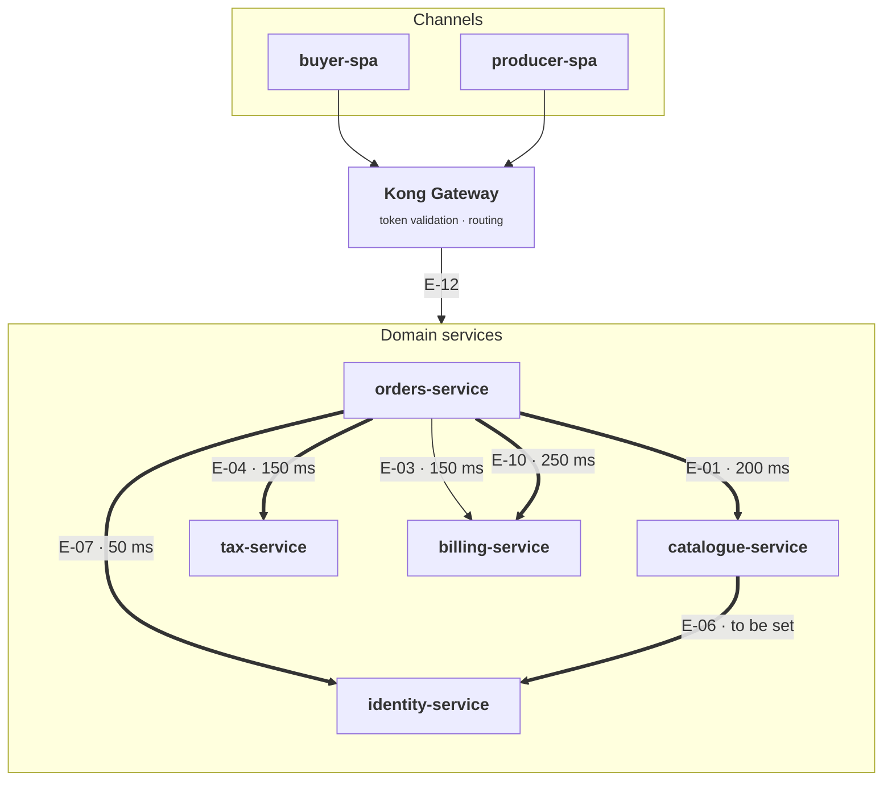
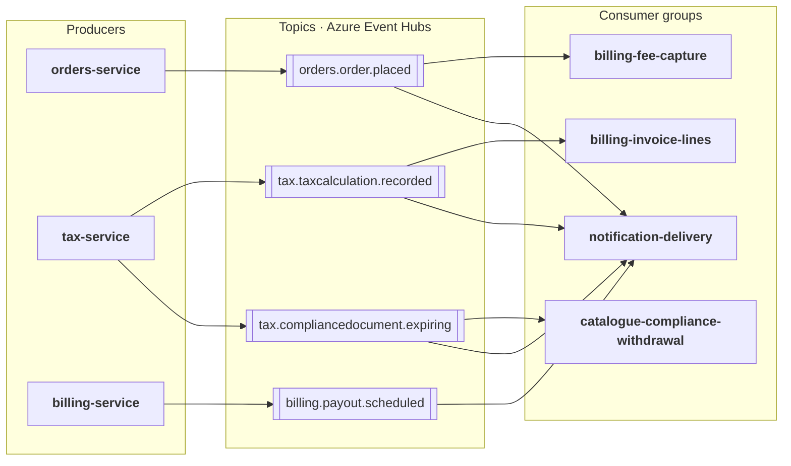
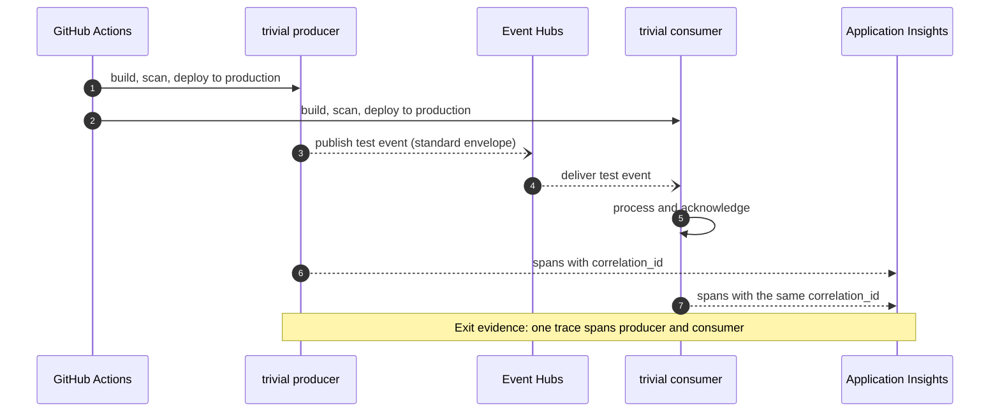
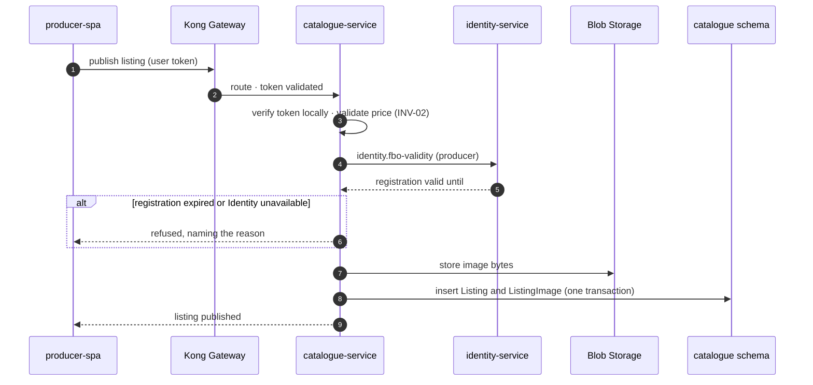
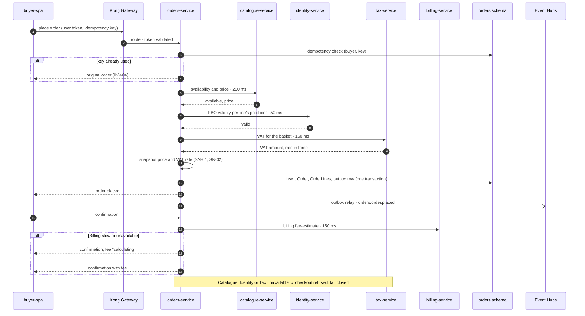
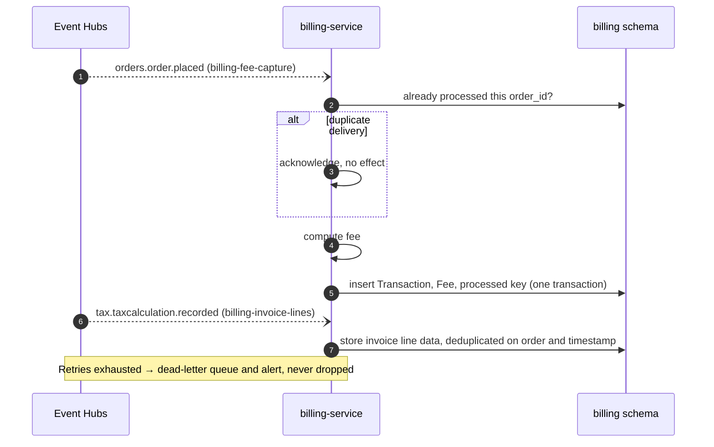
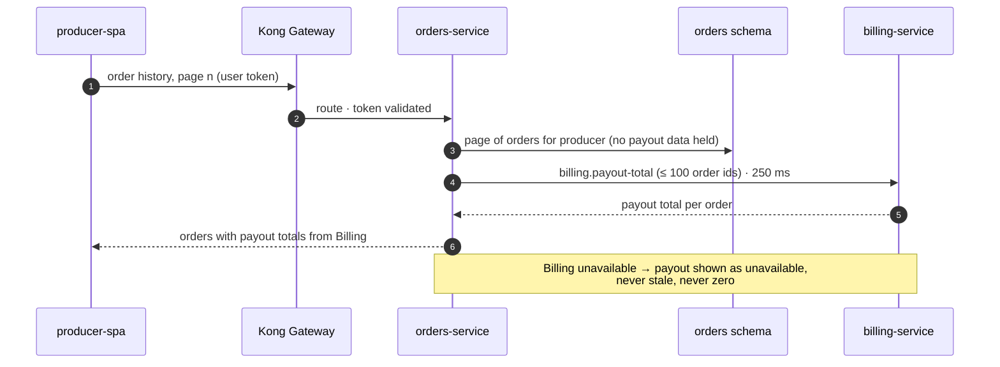
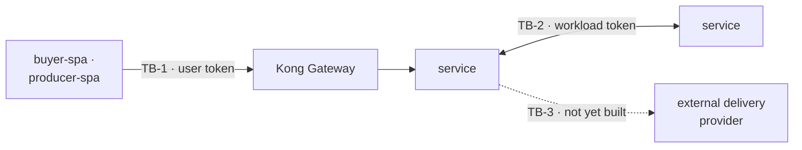

# HarvestLink Solution Architecture

**HarvestLink · Solution Architecture** · Status: **Draft · for review** · Approval blocked by `PEND-01` and `PEND-02`

*Application, data, integration, platform and security architecture for the HarvestLink marketplace on Azure*

## 1. Purpose and Scope

> **PURPOSE**
>
> This document sets out the solution architecture for HarvestLink, the marketplace where food producers list what they sell and buyers order it. It describes **which components make up the application and what each is responsible for**, **where every business entity is stored and how long it is kept**, **how components communicate and what happens when one fails**, and **what platform the solution runs on**. It realises the HarvestLink Target Architecture (`target-architecture.md`, version 4.2), whose principles, constraints and demands it cites by key, and it names the technology chosen to meet each demand.

> **KEY ARCHITECTURAL ASSUMPTION**
>
> The domain boundaries are fixed by the target: **six bounded contexts, five realised by one service that is the single system of record for its entities, and one stateless notification service**. This document does not revisit them. It runs the solution on **Azure in UK South**, with UK West for backup and recovery only. Integration is **event-driven by default**, with a small, named set of budgeted synchronous calls on the request path. Financial and tax records are held **immutably for at least ten years**.

### What this document covers

#### In scope

- **Application architecture**: components, responsibilities, dependencies and shared patterns.
- **Data architecture**: entity ownership, the snapshot register, classification, retention and the two data planes.
- **Integration architecture**: interaction rules, the decision for every interaction in the target, contracts, topics and the critical flows.
- **Platform and security architecture**: hosting, environments, delivery, observability, resilience, the capability register and implemented controls.

#### Not attempted here

- **Domain decomposition**, owned by the target.
- **Component internals**: module design, schema DDL and field-level mapping, held in each component's design.
- **Full interface specifications**, held in each service's OpenAPI contract.
- **Delivery planning**, estimates and run-books.

> **READING THIS DOCUMENT**
>
> **Section 2** gives the solution overview · **Section 3** states the drivers and principle compliance · **Section 4** describes the application architecture · **Section 5** the data architecture · **Section 6** the integration architecture · **Section 7** the end-to-end flows · **Section 8** the platform architecture · **Section 9** the security architecture · **Section 10** traces every demand to its realisation · **Section 11** records risks and open items · **Section 12** consolidates the decisions. Items carry stable keys (`APL-`, `DAT-`, `INT-`, `PLT-`, `QA-`, `SN-`, `FLOW-`, `SD-`, `RK-`, `AS-`, `PEND-`). Keys such as `CON-3`, `E-04`, `SEC-2` or `REQ-INT-07` refer to the target.

---

## Document Control and Contents

*Identity, ownership and approval of this document, and how it is organised*

| Attribute | Value |
|---|---|
| **Document** | solution-architecture.md · HarvestLink |
| **Document type** | Solution architecture |
| **Realises** | target-architecture.md, version 4.2 |
| **Status** | Draft, for review. Approval is blocked by `PEND-01` and `PEND-02` |
| **Lifecycle** | Written at Cycle 0; edited in place on change branches and versioned by git |
| **Section owners** | Solution Architect: Sections 2–7 and 9–12 · Platform Lead: Section 8 |
| **Change control** | Approved by the Solution Architect, with the Platform Lead for Section 8. A change that would amend the target needs an ADR approved by the Enterprise Architect |
| **Technology source** | Approved platform catalogue STD-TECH-01, version 1.1, status approved |
| **Decision records** | ADR-001 to ADR-009 (target); solution decisions `SD-01` to `SD-17` (Section 12) |
| **Classification** | Internal |

### Approvals

| Role | Responsibility | Signature | Date |
|---|---|---|---|
| **Solution Architect** | Owner; approver of Sections 2–7 and 9–12 |   |   |
| **Platform Lead** | Approver of Section 8; signs the Cycle 0 exit proof |   |   |
| **Enterprise Architect** | Reviewer; conformance with the target; owner of `PEND-01` and `PEND-02` |   |   |
| **Information Security** | Reviewer; Section 9 and the classification mapping |   |   |
| **Data Protection** | Reviewer; classification, residency and erasure |   |   |

### How to read the status tags

> **Ratified** the decision is recorded in an approved ADR. **Approved** the product is in the approved platform catalogue for Azure with lifecycle *adopt*, and this document selects it. **Requires validation** the decision is this document's recommendation; it needs confirmation by a named owner before it is relied on, and carries an open item. **Planned** the element is designed but not yet built. **Not yet built** a later delivery band needs the capability; the first change that needs it provisions it.

### Contents

- [1. Purpose and Scope](#1-purpose-and-scope)
- [Document Control and Contents](#document-control-and-contents)
- [2. Solution Overview](#2-solution-overview)
- [3. Architectural Drivers and Principle Compliance](#3-architectural-drivers-and-principle-compliance)
- [4. Application Architecture](#4-application-architecture)
- [5. Data Architecture](#5-data-architecture)
- [6. Integration Architecture](#6-integration-architecture)
- [7. End-to-End Flows](#7-end-to-end-flows)
- [8. Platform Architecture](#8-platform-architecture)
- [9. Security Architecture](#9-security-architecture)
- [10. Requirements Traceability](#10-requirements-traceability)
- [11. Risks, Assumptions and Open Items](#11-risks-assumptions-and-open-items)
- [12. Decision Summary and Implementation Implications](#12-decision-summary-and-implementation-implications)
- [Appendix A. Glossary and Abbreviations](#appendix-a-glossary-and-abbreviations)

---

## 2. Solution Overview

*What the solution is made of, and how its parts fit together*

> **ARCHITECTURE POSITION**
>
> HarvestLink is delivered as **six domain services and two web applications**, running as containers on Azure Container Apps. Each of the five stateful services owns one PostgreSQL schema and is granted no other. Services publish business facts to Azure Event Hubs, and call each other synchronously only where the target needs the answer inside a user's request. Every call from a browser enters through Kong Gateway. Financial and tax evidence is written to Blob Storage under a locked retention policy that no operator can shorten.

### Logical solution architecture



***FIGURE 1** · Logical solution architecture: channels, edge, domain services and the platform they run on. Key Vault, Managed Identity and Application Insights serve every service.*

### Technology view

| Logical component | Technology | Decision |
|---|---|---|
| **Domain services** | Azure Container Apps, one app per component | `SD-01` **Approved** |
| **Cloud and region** | Azure; UK South primary, UK West for backup and recovery only | `SD-02` **Approved** |
| **Operational store** | Azure Database for PostgreSQL – Flexible Server, one schema per service | `SD-03` **Ratified** engine · **Approved** product |
| **Event backbone** | Azure Event Hubs | `SD-04` **Approved** |
| **API gateway** | Kong Gateway, single ingress | `SD-05` **Approved** |
| **External-party identity** | Microsoft Entra External ID | `SD-06` **Approved** |
| **Secrets and workload identity** | Azure Key Vault and Azure Managed Identity | `SD-07` **Approved** |
| **Observability** | Azure Monitor and Application Insights, with OpenTelemetry | `SD-08` **Approved** |
| **Object storage and evidence archive** | Azure Blob Storage; locked time-based immutability for evidence | `SD-09` · `SD-10` **Approved** |
| **Delivery pipeline** | GitHub Actions and Terraform; Azure Container Registry | `SD-11` **Approved** · `SD-12` **Requires validation** |
| **Contract verification** | Pact, provider-verified on every build | `SD-13` **Requires validation** |
| **Web applications** | Static hosting on Blob Storage, served through Azure Front Door | `SD-14` **Requires validation** |
| **Search, scheduled jobs, analytical store, evidenced email** | Provisioned by the first change that needs each one (`PLT-6`) | **Not yet built** |

> **WHAT THIS OVERVIEW SHOWS**
>
> The solution keeps **the request path short and the record path immutable**. A buyer's checkout touches the gateway, Orders and three named dependencies. Everything that follows the order, from fee capture to invoice data and notices, runs asynchronously off the event backbone and writes to stores whose retention cannot be shortened.

---

## 3. Architectural Drivers and Principle Compliance

*The requirements, qualities and constraints the solution is designed against*

> **WHAT DRIVES THE DESIGN**
>
> Three of the forces on HarvestLink are regulatory: tax audit, VAT, and food-business-operator (FBO) registration. The solution is therefore shaped first by **ownership, immutability and reproducibility**, and second by latency. The quality attributes below are the measurable form of the target's demands, and each has a named mechanism in this document.

### Quality attributes and how they are met

| Key | Attribute and target | Primary mechanism | Section |
|---|---|---|---|
| **QA-01** | Checkout ≤ 800 ms p95 | Budget split: Catalogue 200 + Tax 150 + Identity 50 ms, leaving 400 ms for Orders' own validation and persistence. Each call's timeout equals its share | `INT-1`, `FLOW-02` |
| **QA-02** | Order confirmation ≤ 400 ms p95 | Fee lookup ≤ 150 ms; on timeout the fee shows as "calculating", never as a guess | `INT-1`, `APL-4` |
| **QA-03** | Order history ≤ 600 ms p95 | One batched payout-total call per page: ≤ 100 orders in ≤ 250 ms | `INT-1`, `FLOW-04` |
| **QA-04** | Order-placed notice reaches Billing ≤ 5 s end to end | Transactional outbox, Event Hubs, idempotent consumer | `INT-3`, `FLOW-03` |
| **QA-05** | Every request authenticated, no anonymous path | Token validated at the gateway and again in each service | `SEC-1`, `TB-1`, `TB-2` |
| **QA-06** | Financial and tax records ≥ 10 y, demonstrably immutable | Append-only tables with a trigger backstop; locked Blob retention | `DAT-1`, `PLT-5` |
| **QA-07** | Availability 99.9% for billing, tax and identity | Regulatory-defence tier; the other components' tiers are `PEND-07` | `PLT-5` |
| **QA-08** | Search ≤ 300 ms p95 | **Not yet built**; band Second, C2 | `PLT-6` |
| **QA-09** | Statement batch ≤ 90 min for 10⁴ producers, nightly | **Not yet built**; band Second, C4a | `PLT-6` |
| **QA-10** | Analytical freshness ≤ 24 h | **Not yet built**; band Second, C4a | `DAT-4`, `PLT-6` |

### Principle compliance

| Principle | Position | How the solution complies |
|---|---|---|
| **L1-ARCH-01** | **Satisfied** | One service per bounded context; no service holds another context's entities (`APL-1`). |
| **L1-ARCH-02** | **Recorded deviation, scope open** | Events carry every after-the-fact interaction. `DEV-1` approves two synchronous flows (`E-01`, `E-03`). Four further edges must be synchronous (`E-04`, `E-06`, `E-07`, `E-10`); whether `DEV-1` covers them is `PEND-01`. |
| **L1-ARCH-03** | **Satisfied** | Every interface is a published, versioned OpenAPI contract or registered event schema (`INT-2`, `DAT-2`). |
| **L1-ARCH-04** | **Satisfied** | PostgreSQL for the operational store (`SD-03`). |
| **L1-SEC-01** | **Satisfied** | A Managed Identity per component; secrets only in Key Vault; no stored cloud credentials (`SEC-4`). |
| **L1-SEC-02** | **Satisfied** | Classification sets the encryption, residency and erasure policy for every entity (`DAT-3`, `SEC-2`). |
| **L1-DATA-01** | **Satisfied** | One system of record per entity, enforced by schema grants (`DAT-1`). |

### Constraints honoured

| Constraint | How the solution honours it | Section |
|---|---|---|
| **CON-1** | One Container App per component, each with its own schema and no shared runtime state | `PLT-1` |
| **CON-2** | Every entity has one owning schema, and no other service is granted it | `DAT-1.a` |
| **CON-3** | Schema grants stop cross-context reads at connection time. Only registered snapshots and registered analytical read models cross a boundary | `DAT-1.b`, `DAT-4` |
| **CON-4** | Every interaction runs over a published, versioned contract or topic | `INT-2`, `DAT-2` |
| **CON-5** | The payout total is fetched from Billing, never stored or recomputed by Orders; web apps read through the owner's contract | `INT-1` (`E-10`, `E-12`) |
| **CON-6** | Entra External ID issues every token and identity-service publishes the keys; no service authenticates on its own | `SEC-1`, `INT-1` (`E-08`) |
| **CON-7** | `DEV-1` is realised as approved; the four further synchronous edges are raised as `PEND-01`, not quietly built | `INT-1`, Section 11 |
| **CON-8** | Every snapshot is registered, captured once through the owner's contract, and never reconciled | `DAT-1.e` |
| **CON-9** | Two-plane model; the analytical store follows at band Second, C4a | `DAT-4` |

---

## 4. Application Architecture

*Components, their responsibilities and dependencies, and the patterns they share* · Keys: `APL`

### APL-1 · Component catalogue

| Component | Kind | Context | Owns (schema) | Status | Realises |
|---|---|---|---|---|---|
| **catalogue-service** | Service | Catalogue | `catalogue` | **Planned** | `INV-01`, `INV-02` |
| **orders-service** | Service | Orders | `orders` | **Planned** | `INV-01`, `INV-03`, `INV-04` |
| **billing-service** | Service | Billing | `billing` | **Planned** | `INV-05`, `INV-06` |
| **identity-service** | Service | Identity | `identity` | **Planned** | `CON-6` |
| **tax-service** | Service | Tax & Compliance | `tax` | **Planned** | `INV-07` |
| **notification-service** | Service | Notifications | None, stateless | **Planned** | `E-09` |
| **buyer-spa** | Experience | — | None | **Planned** | `E-12` |
| **producer-spa** | Experience | — | None | **Planned** | `E-12` |
| **batch-runner** | Platform | — | None | **Not yet built** (band Second, C4a) | `REQ-PLT-08` |

### APL-2 · Service designs

#### catalogue-service

*Catalogue · producer-facing*

**Responsible for.** Listing lifecycle (draft, published, withdrawn), publication, and the search projection once search is built.

**Not responsible for.** Pricing policy or fee calculation.

**Provides.** `catalogue.listing-availability` to Orders; the catalogue experience API.

**Depends on.** identity-service for FBO validity at publication (`E-06`, fail closed). Consumes `tax.compliancedocument.expiring` to withdraw affected listings (`E-11`).

**Notable rules.** Price is a positive minor-unit integer (`INV-02`). A listing is not published while its producer's FBO registration is expired (`INV-01`).

#### orders-service

*Orders · buyer-facing*

**Responsible for.** Order lifecycle and checkout orchestration.

**Not responsible for.** Computing anything financial. Fee, VAT and payout come from their owners.

**Provides.** `orders.order.placed`; the orders experience API.

**Depends on.** Catalogue (`E-01`), Tax (`E-04`) and Identity (`E-07`) at checkout, all fail closed. Billing at confirmation (`E-03`, degrades) and at order history (`E-10`, fails closed).

**Notable rules.** Placement is idempotent on `(buyer_id, idempotency_key)` (`INV-04`). Price and VAT rate are snapshotted at placement and never re-read (`INV-03`, `INV-07`). Holds no payout figure (`ADR-009`).

#### billing-service

*Billing · money movement*

**Responsible for.** Fee calculation, transactions, payouts and statements.

**Not responsible for.** Order state.

**Provides.** `billing.fee-estimate` and `billing.payout-total` to Orders; `billing.payout.scheduled`.

**Depends on.** No synchronous dependency on any service. Learns of orders from `orders.order.placed` (`E-02`) and receives invoice line data from `tax.taxcalculation.recorded` (`E-05`), so an Orders outage delays fee capture but cannot stop it.

**Notable rules.** A fee has no life apart from its transaction (`INV-05`) and is immutable once written (`INV-06`).

#### identity-service

*Identity · upstream of every context*

**Responsible for.** Authentication and authorisation, producer and buyer profiles, and FBO registration validity.

**Not responsible for.** The business authorisation rules of other contexts.

**Provides.** `identity.fbo-validity` to Catalogue and Orders; the signing keys every service uses to verify tokens locally (`E-08`).

**Depends on.** Microsoft Entra External ID. No dependency on any other service.

**Notable rules.** No other service implements authentication (`CON-6`). One validity check serves publication and checkout, so both apply the same rule.

#### tax-service

*Tax & Compliance · tax policy*

**Responsible for.** Effective-dated rate resolution, compliance-rule evaluation and invoice composition.

**Not responsible for.** Moving money, or deciding whether an order may proceed.

**Provides.** `tax.vat-amount` to Orders; `tax.taxcalculation.recorded`; `tax.compliancedocument.expiring`.

**Depends on.** No synchronous dependency on any service.

**Notable rules.** A rate is never updated in place. A new rate is a new row with its own validity window, so the rate in force at any instant can be reproduced (`INV-07`).

#### notification-service

*Notifications · stateless*

**Consumes.** `orders.order.placed`, `tax.taxcalculation.recorded`, `billing.payout.scheduled` and `tax.compliancedocument.expiring` (`E-09`).

**Not responsible for.** Deciding whether something is noteworthy. The publisher decides.

**Design intent.** Owns no entities, so delivery can be retried, replayed or replaced without a data migration. The delivery channel arrives with evidenced outbound delivery at band Third (`REQ-PLT-06`).

### APL-3 · Experience and platform components

| Component | Design | Rules it must keep |
|---|---|---|
| **buyer-spa** | Single-page application for browsing, basket and checkout, signed in through Entra External ID. | Generates one idempotency key per checkout attempt and reuses it on retry. Shows the fee as "calculating" until Billing answers. Enforces no rule the server does not also enforce. |
| **producer-spa** | Single-page application for listings, publication and order history with payout totals. | Shows a payout total only as Billing returns it; when Billing is unavailable it shows the figure as unavailable, never stale and never zero. |
| **batch-runner** | Job runtime for scheduled, non-interactive work such as the statement batch. **Not yet built**: band Second, C4a. | Each job is owned by one context and runs under that context's workload identity, because two contexts must not share a credential. Owns no entities and no business rules. |

### APL-4 · Cross-cutting application patterns

| Pattern | Design | Why |
|---|---|---|
| **Transactional outbox** | Every event is written to an outbox table in the same transaction as the state change; a relay publishes it to Event Hubs. | A broker outage must never fail a business action, and no event is published for a change that rolled back |
| **Idempotent consumers** | Each consumer records the business key it processed (for example `order_id`) in the same transaction as its effect. | Delivery is at-least-once; a fee must never be captured twice |
| **Idempotent commands** | Order placement requires an idempotency key; a repeat returns the original order. | `INV-04` |
| **Bounded retries and dead letters** | Retries with backoff, then a dead-letter queue per consumer and an alert. | A poison message must not block other producers' or buyers' events |
| **Timeouts and circuit breakers** | Every synchronous call has a timeout equal to its budget and a circuit breaker. | A slow dependency must fail fast inside the caller's budget |
| **Money representation** | Positive minor-unit integers with an explicit currency, in code, contracts and storage. | `INV-02` |
| **Correlation** | A `correlation_id` is created at the edge and carried in headers, trace context and every event envelope. | `REQ-PLT-05` |
| **Expand and contract** | A breaking change adds the new form, migrates consumers, deprecates the old form, then removes it. | Provider and consumer release independently |

#### Failure policy

| Dependency failure | Behaviour | Reason |
|---|---|---|
| **Catalogue, Tax or Identity at checkout** | **Fail closed** checkout refused | An order without a valid seller, a current price or correct VAT is a regulatory exposure |
| **Identity at listing publication** | **Fail closed** publication refused | `INV-01` |
| **Billing at order confirmation** | **Degrade** fee shown as "calculating" | The order is placed; the confirmation still renders and asserts nothing false |
| **Billing at order history** | **Fail closed** payout shown as unavailable | The value has one source; a stale or recomputed figure breaches `CON-5` |
| **Any event consumer** | **Retry** then dead letter and alert | The target says these notices may be delayed but never lost |

---

## 5. Data Architecture

*Where every entity lives, who owns it, how long it is kept, and how it may be shared* · Keys: `DAT`

> **DATA POSITION**
>
> Every entity has **one owning service and one physical home**. Services refer to each other's entities **by identifier only**. A value from another context may be held only as a **registered snapshot** frozen at an event, or read through a **registered analytical read model**. Anything else is a defect, and the registers below are how that is checked.

### DAT-1 · Entity ownership

All entities are **Planned** at Cycle 0, and all reside in UK South. Notifications owns no entities, so it has no row.

| Entity | System of record | Classification | Retention | Physical location |
|---|---|---|---|---|
| **Product** | Catalogue | Public | To be set (`PEND-03`) | `catalogue.product` |
| **Listing** | Catalogue | Public | To be set (`PEND-03`) | `catalogue.listing` |
| **Category** | Catalogue | Public | To be set (`PEND-03`) | `catalogue.category` |
| **ListingImage** | Catalogue | Public | To be set (`PEND-03`) | `catalogue.listing_image` (key) · Blob Storage (bytes) |
| **Order** | Orders | Confidential | To be set (`PEND-03`) | `orders.order` |
| **OrderLine** | Orders | Confidential | To be set (`PEND-03`) | `orders.order_line` |
| **OrderStatus** | Orders | Confidential | To be set (`PEND-03`) | `orders.order_status` |
| **Transaction** | Billing | Restricted · Financial | ≥ 10 y | `billing.transaction` |
| **Fee** | Billing | Restricted · Financial | ≥ 10 y | `billing.fee` |
| **Payout** | Billing | Restricted · Financial | ≥ 10 y | `billing.payout` |
| **Statement** | Billing | Restricted · Financial | ≥ 10 y | `billing.statement` |
| **Producer** | Identity | Confidential · PII | To be set (`PEND-03`) | `identity.producer` |
| **Buyer** | Identity | Confidential · PII | To be set (`PEND-03`) | `identity.buyer` |
| **Session** | Identity | Confidential · PII | To be set (`PEND-03`) | `identity.session` |
| **FboRegistration** | Identity | Confidential | 6 y | `identity.fbo_registration` |
| **TaxRate** | Tax & Compliance | Restricted · Financial | ≥ 10 y | `tax.tax_rate` |
| **TaxRule** | Tax & Compliance | Restricted · Financial | ≥ 10 y | `tax.tax_rule` |
| **Invoice** | Tax & Compliance | Restricted · Financial | ≥ 10 y | `tax.invoice` |
| **ComplianceDocument** | Tax & Compliance | Confidential | 6 y | `tax.compliance_document` |

#### Data rules

| Rule | Statement |
|---|---|
| **DAT-1.a** | Exactly one system of record per entity. No exceptions. Realises `CON-2`. |
| **DAT-1.b** | A non-owning context holds references **by identifier only**, except for a registered snapshot (`DAT-1.e`) or a registered analytical read model (`DAT-4`). The payout column removed under `ADR-009` must not return. Realises `CON-3`. |
| **DAT-1.c** | Money is stored as a positive minor-unit integer with an explicit currency. Floating-point money is prohibited. Realises `INV-02`. |
| **DAT-1.d** | Order placement is unique on `(buyer_id, idempotency_key)`; a repeat returns the original order. Realises `INV-04`. |
| **DAT-1.e** | A snapshot is captured once, through the owner's published contract, at the event that freezes it, and is never reconciled with its source. It is registered below, and its column name states its meaning (`…_at_placement`). An unregistered cross-context copy is a defect. Realises `CON-8`, `INV-03`, `INV-07`. |
| **DAT-1.f** | A `Fee` row is never updated or deleted once written. Corrections are new compensating rows that reference the original. Realises `INV-06`. |
| **DAT-1.g** | A tax rate is effective-dated. A change is a new row with its own validity window, never an update, so the rate in force at any instant can be reproduced. Realises `INV-07`. |

#### Snapshot register

| Key | Source (owner) | Capturing column | Frozen by | Captured through |
|---|---|---|---|---|
| **SN-01** | Listing price (Catalogue) | `orders.order_line.price_at_placement` | Order placement | `catalogue.listing-availability` (`E-01`) |
| **SN-02** | Tax rate in force (Tax & Compliance) | `orders.order_line.vat_rate_at_placement` | Order placement | `tax.vat-amount` (`E-04`) |

> **REGISTER GAP**
>
> The target records four registered snapshots, one explicit non-entry and two registered analytical read models as of BX-2. The two snapshots above are the ones its invariants name. The other two snapshots, the non-entry and both read models are counted in the target but not named, and they are reconciled under `PEND-09`. None is invented here.

#### Integrity mechanisms

| Concern | Mechanism | Realises |
|---|---|---|
| **Fee immutability** | (1) No update or delete grant on `billing.fee` for the service's role; (2) a trigger that rejects every update or delete unconditionally; (3) corrections as compensating rows; (4) a copy in the locked evidence archive (`PLT-5`). | `INV-06`, `REQ-DAT-04` |
| **Effective-dated rates** | Validity-window columns, and a database constraint that refuses two rates in force for the same country at once. | `INV-07`, `REQ-DAT-06` |
| **Idempotent placement** | Unique constraint on `(buyer_id, idempotency_key)`, checked before insert. | `INV-04` |

> **WHY MORE THAN ONE MECHANISM**
>
> A database grant can be changed by an administrator, so on its own it does not demonstrate immutability to a tax auditor. The trigger survives a revoked grant or an application defect, and the locked archive survives both. Each mechanism covers a failure the others do not.

### DAT-2 · Event envelope and schema governance

Every event on every topic carries the standard envelope. Payloads are versioned JSON schemas, registered per event type. Satisfies `REQ-DAT-03`; realises `CON-4`.

```json
{
  "event_id":       "uuid",
  "event_type":     "{context}.{entity}.{event}",
  "schema_version": "semver",
  "occurred_at":    "RFC 3339 timestamp",
  "correlation_id": "uuid",
  "producer":       "service name",
  "payload":        { }
}
```

| Change | Rule |
|---|---|
| **Add an optional field** | Minor version; published directly |
| **Remove, rename or retype** | Major version; expand and contract: publish both, migrate consumers, remove the old form one release later |
| **Evidence events** | The schema version that applied is also stored on the record itself (the invoice line, the rate snapshot), so it can be answered years later |
| **Personal data** | Events carry identifiers, not personal data |

| Event type | Version | Producer | Consumers | Kind | Status |
|---|---|---|---|---|---|
| **orders.order.placed** | 1.0.0 | orders-service | billing-service, notification-service | Lifecycle | **Planned** |
| **tax.taxcalculation.recorded** | 1.0.0 | tax-service | billing-service, notification-service | Evidence | **Planned** |
| **billing.payout.scheduled** | 1.0.0 | billing-service | notification-service | Notification | **Planned** |
| **tax.compliancedocument.expiring** | 1.0.0 | tax-service | catalogue-service, notification-service | Lifecycle | **Planned** |

`tax.taxcalculation.recorded` is an Evidence event. It is strictly ordered per order, deduplicated on `(order_id, business timestamp)`, and **never replayed**, because a replay would assert the same calculation a second time.

### DAT-3 · Classification, residency and retention

Satisfies `REQ-DAT-02`; realises `SEC-2`.

| Class | Handling tag | Retention | Residency | At rest | Erasure request |
|---|---|---|---|---|---|
| **Public** | — | To be set (`PEND-03`) | UK South | Platform default encryption | Not applicable: holds no personal data |
| **Confidential** | — | 6 y for FBO registrations and compliance documents; to be set for orders (`PEND-03`) | UK South | Encrypted at rest and in transit, group-managed keys | Honoured, except records held for the 6-year compliance obligation |
| **Confidential** | PII | To be set (`PEND-03`) | UK South; UK data subjects stay in the UK or an adequacy jurisdiction | Encrypted, group-managed keys; every access attributable to a principal | Honoured (UK GDPR Art. 17) |
| **Restricted** | Financial | ≥ 10 y | UK South, the financial-data region; never replicated outside it, including into the analytical plane | Encrypted, group-managed keys; locked immutability for evidence | **Overridden**: statutory retention |

| Store | Classification applied | Notes |
|---|---|---|
| `catalogue.*` | Public | Producer identity is held by reference only |
| `orders.*` | Confidential | Buyer identity by reference; a snapshot holds no personal data |
| `billing.*`, `tax.tax_rate`, `tax.tax_rule`, `tax.invoice` | Restricted · Financial | Erasure overridden for the full retention period |
| `identity.producer`, `identity.buyer`, `identity.session` | Confidential · PII | The erasure population is kept distinct from the compliance-retained population |
| `identity.fbo_registration`, `tax.compliance_document` | Confidential | Retained 6 y as compliance evidence |
| **Backups, recovery copies, log exports** | Inherit the source's class and residency | A copy is not a new residency decision |

> **THE CLASS MAPPING NEEDS CONFIRMATION**
>
> The target's `SEC-2` keys controls to **PII** and **Financial**. The group standard has four classes: Public, Internal, Confidential and Restricted. This document maps PII to **Confidential** ("sensitive to a specific party") and Financial to **Restricted** ("legally or financially sensitive"), and keeps PII and Financial as handling tags so the `SEC-2` controls still apply. Information Security confirms the mapping under `PEND-08`.

### DAT-4 · Operational and analytical planes

Satisfies `REQ-DAT-05`.

| Plane | Realisation | Status |
|---|---|---|
| **Operational** | One schema per stateful service on Azure Database for PostgreSQL – Flexible Server; no cross-schema grants | **Approved** |
| **Object** | Listing image bytes in Blob Storage, referenced by id from `catalogue.listing_image` | **Approved** |
| **Evidence archive** | A Blob Storage container under a locked time-based retention policy | **Approved** |
| **Analytical** | Two-plane model under `CON-9`: each read model is derived, owned by one context, never a source of truth, and fresh within 24 h | Model **Ratified** (`ADR-007`) · store **Not yet built**, band Second, C4a |

> **WHY THE ANALYTICAL STORE WAITS**
>
> `ADR-007` settled the model, and it is not reopened here. The store is a later-band capability with no registered read model to serve yet, so provisioning it now would fix a technology and a freshness commitment against a need that does not exist. The approved catalogue lists a product-scoped analytical store for AWS only. On Azure, the first change that specifies a read model proposes one, with PostgreSQL and materialised views as the natural candidate. Wherever it lands, Financial data must stay in UK South.

---

## 6. Integration Architecture

*How components communicate, which contracts they publish, and what each interaction costs* · Keys: `INT`

### INT-1 · Interaction style rules and decisions

> **THE RULE**
>
> Communication between services is an **event** unless the answer is needed inside a user's request **and** one of the following holds: (1) the transaction cannot proceed on "it may be true", as with availability; (2) a figure shown must be the figure later charged, as with price, fee and VAT; (3) an ineligible party must be refused at the point of action, not compensated afterwards, as with FBO validity. Then it is a **synchronous call** with a budget, a timeout equal to that budget, and a declared failure behaviour. The degraded mode is a refusal or a deferral, never an optimistic assumption. Satisfies `REQ-INT-01`.



***FIGURE 2** · Synchronous integration view. Thick arrows fail closed; the thin arrow to Billing degrades. Arrows run from caller to provider. `E-08` has no arrow: tokens are verified locally, with no runtime call.*

For calls, the interaction reads from caller to provider; for events, from publisher to consumer.

| Edge | Interaction | Style | Budget p95 | On failure | Why this style | Permitted by |
|---|---|---|---|---|---|---|
| **E-01** | Orders → Catalogue: availability and price at checkout | Sync | 200 ms (`REQ-INT-03`) | Fail closed | The price shown must be the price charged, then frozen (`SN-01`) | `DEV-1` |
| **E-02** | Orders → Billing: order placed | Event | ≤ 5 s end to end (`REQ-INT-04`) | Retry, then dead letter | After the fact; may be delayed, never lost | Default |
| **E-03** | Orders → Billing: fee at confirmation | Sync | 150 ms inside 400 ms (`REQ-INT-06`) | Degrade to "calculating" | The fee shown is the fee charged | `DEV-1` |
| **E-04** | Orders → Tax: VAT at checkout | Sync | 150 ms inside 800 ms (`REQ-INT-07`) | Fail closed | No untaxed checkout | `PEND-01` |
| **E-05** | Tax → Billing: invoice line data | Event | No request-path budget; the 150 ms of `REQ-INT-07` belongs to `E-04` | Retry, then dead letter | After the fact | Default |
| **E-06** | Catalogue → Identity: FBO validity at publication | Sync | Zero staleness; time budget `PEND-04` | Fail closed | An expired producer must be refused at publication (`INV-01`) | `PEND-01` |
| **E-07** | Orders → Identity: FBO validity at checkout | Sync | 50 ms inside 800 ms (`REQ-INT-08`) | Fail closed | A registration can lapse between publication and checkout (`INV-01`) | `PEND-01` |
| **E-08** | Every service → Identity: caller identity and permissions | Local token verification | 100% of requests (`REQ-INT-09`) | Token refused at the gateway or the service | Keys are cached, so there is no runtime call to budget | Not an inter-context call |
| **E-09** | Orders, Billing, Tax → Notifications: notices | Event | At-least-once; latency `PEND-05` | Retry, then dead letter | After the fact; never lost | Default |
| **E-10** | Orders → Billing: payout total at order history | Sync | 250 ms, ≤ 100 ids, inside 600 ms (`REQ-INT-11`) | Fail closed: shown as unavailable | The value has one source (`ADR-009`, `CON-5`) | `PEND-01` |
| **E-11** | Tax → Catalogue: compliance document expiring | Event | At-least-once; latency `PEND-06` | Retry, then dead letter | After the fact; never lost | Default |
| **E-12** | Web apps → owning services: every read and command | Sync, through Kong | Declared per contract before it ships (`REQ-INT-13`) | Per contract | Client to server, not an inter-context flow | `CON-5` |

> **THE DEV-1 SCOPE QUESTION**
>
> `DEV-1` approves two named synchronous flows: `E-01` and `E-03`. Four further edges (`E-04`, `E-06`, `E-07`, `E-10`) must also be synchronous, because their own budgets say "must succeed" and an event cannot meet that. Whether `DEV-1` is widened or the four are recorded as deviations to remove is the Enterprise Architect's decision (`OQ-03`). It is carried as `PEND-01` and blocks approval.

> **REJECTED ALTERNATIVE**
>
> Event-carried state for `E-03` and `E-10` was rejected. Orders would have to hold a replicated fee or payout value, which `CON-3` forbids, and `ADR-009` removed exactly such a column.

### INT-2 · API architecture and contracts

Satisfies `REQ-INT-02`, `REQ-INT-13`; realises `CON-4`, `CON-5`, `SEC-3`.

#### API standards

- Every interface is described in OpenAPI and published with its service. No shared library carries domain types across a service boundary.
- Versioned by semver: an additive change is minor, a breaking change is major and ships by expand and contract.
- Consumer-driven contract tests are verified by the provider on every build. Verification is enumerated from the consumers' pacts, not from this catalogue (`SD-13`).
- Every operation declares its authentication in the contract (`SEC-3`).
- Every user-facing operation declares its p95 before release (`REQ-INT-13`).

#### Gateway and routing

- Kong Gateway is the single ingress for every experience-facing contract and validates the user's token at the edge (`TB-1`).
- Service-to-service calls stay inside the private network and do not pass through the gateway. Each service verifies the caller's workload token locally (`TB-2`).

Operation paths are indicative; each service's OpenAPI contract is authoritative.

| Contract · operation | Owner | Consumers | Auth | Budget p95 | Status |
|---|---|---|---|---|---|
| **catalogue.listing-availability** · `GET /v1/listings/{listingId}/availability` | catalogue | orders | Workload | 200 ms | **Planned** |
| **billing.fee-estimate** · `GET /v1/orders/{orderId}/fee` | billing | orders | Workload | 150 ms | **Planned** |
| **tax.vat-amount** · `POST /v1/vat-calculations` | tax | orders | Workload | 150 ms | **Planned** |
| **identity.fbo-validity** · `POST /v1/producers/fbo-validity` | identity | catalogue, orders | Workload | 50 ms at checkout; publication `PEND-04` | **Planned** |
| **billing.payout-total** · `POST /v1/payout-totals` | billing | orders | Workload | 250 ms · ≤ 100 ids | **Planned** |
| **identity.signing-keys** · `GET /.well-known/jwks.json` | identity | Kong, every service | Public keys | Fetched and cached; no per-request call | **Planned** |
| **{context}.experience-api** | each stateful service | buyer-spa, producer-spa | User token | Declared per operation before it ships | **Planned** |

> **THE PAYOUT FIGURE HAS ONE SOURCE**
>
> Orders displays the payout total but never stores or computes it. One batched call per page of order history asks Billing for up to 100 totals. When Billing cannot answer, the figure is shown as unavailable rather than stale, so a producer never reconciles against a number Billing did not produce.

### INT-3 · Event architecture

Satisfies `REQ-INT-02`, `REQ-INT-04`, `REQ-INT-10`, `REQ-INT-12`.



***FIGURE 3** · Event topology: producing services, topics and consumer groups.*

| Topic | Producer | Consumer groups | Ordering key | Retention | Status |
|---|---|---|---|---|---|
| **orders.order.placed** | orders | billing-fee-capture · notification-delivery | `order_id` | Application policy | **Planned** |
| **tax.taxcalculation.recorded** | tax | billing-invoice-lines · notification-delivery | `order_id`, strict | Operational only; the 10-year record is the stored invoice, not the topic | **Planned** |
| **billing.payout.scheduled** | billing | notification-delivery | None | Application policy | **Planned** |
| **tax.compliancedocument.expiring** | tax | catalogue-compliance-withdrawal · notification-delivery | `producer_id` | Application policy | **Planned** |

| Standard | Rule |
|---|---|
| **Naming** | `{context}.{entity}.{event}`: lowercase, dot-separated, past tense, and the context is a bounded context, never a team or system. Consumer groups are `{consuming-context}-{purpose}`. Checked by a guardrail. |
| **Delivery** | At-least-once. Producers publish through the outbox; consumers deduplicate on the business key (`APL-4`). |
| **Failure** | Bounded retries, then a dead-letter queue per consumer group and an alert. |
| **No reflexive events** | State private to one context with no cross-context consumer does not get a topic. |

---

## 7. End-to-End Flows

*The lasting critical paths of the solution, component by component* · Keys: `INT-4`

> **HOW TO READ THE FLOWS**
>
> Each flow is the canonical description of a path that crosses components. Solid arrows are synchronous calls; open arrows are asynchronous deliveries. Budgets are p95. Failure behaviour follows the policy in `APL-4`. A change's own flow is written in its change brief, and copied here only when it becomes a lasting critical path.

| Flow | Path | Components | Key rules |
|---|---|---|---|
| **FLOW-00** | Cycle 0 exit flow | trivial service, Event Hubs, Application Insights | `PLT-3` exit proof |
| **FLOW-01** | Listing publication | producer-spa, catalogue, identity | `INV-01`, `INV-02` |
| **FLOW-02** | Checkout, placement and confirmation | buyer-spa, orders, catalogue, identity, tax, billing | `INV-01`, `INV-03`, `INV-04`, `INV-07` |
| **FLOW-03** | Fee capture and invoice line data | orders, tax, billing | `INV-05`, `INV-06`, `REQ-INT-04` |
| **FLOW-04** | Producer order history with payout totals | producer-spa, orders, billing | `REQ-INT-11`, `ADR-009` |

Compliance-expiry withdrawal (`E-11`) and notices (`E-09`) follow the event pattern of `FLOW-03` and are not drawn.

#### FLOW-00 · Cycle 0 exit flow



***FIGURE 4** · The flow the Platform Lead watches before any feature work starts.*

#### FLOW-01 · Listing publication



***FIGURE 5** · Standing is checked at publication. The checkout half of `INV-01` is enforced in `FLOW-02`, because a registration can lapse between the two.*

#### FLOW-02 · Checkout, placement and confirmation



***FIGURE 6** · Three fail-closed dependencies, called in sequence: 200 + 50 + 150 = 400 ms, leaving 400 ms of the 800 ms budget for Orders. Snapshots are taken after every check and before persistence, so a refused order leaves none behind.*

#### FLOW-03 · Fee capture and invoice line data



***FIGURE 7** · Billing learns of orders by event only and is idempotent on the order id, so redelivery never bills twice. End to end within 5 s (`REQ-INT-04`).*

#### FLOW-04 · Producer order history with payout totals



***FIGURE 8** · One batched call per page replaces a call per order, inside the 600 ms history budget. The figure is computed only by Billing, the context that owns it.*

---

## 8. Platform Architecture

*Where the solution runs, how it is delivered, observed and recovered* · Keys: `PLT`

### PLT-1 · Hosting and runtime topology

Satisfies `REQ-PLT-01` to `REQ-PLT-05` and `REQ-PLT-10`; realises `CON-1`, `CON-6`, `SEC-1`, `SEC-4`.

> **CLOUD AND REGION**
>
> HarvestLink runs on **Azure**, the group's default cloud, in **UK South**, which is approved for every data class and is the financial-data region. **UK West** holds backup and recovery copies only, and they inherit the residency of their source. A product uses one cloud, chosen once, here.

| Runtime element | Configuration | Decision | Satisfies |
|---|---|---|---|
| **Domain services** | One Container App per component; private network only; each with its own Managed Identity | `SD-01` **Approved** | `REQ-PLT-01`, `CON-1` |
| **Operational store** | PostgreSQL Flexible Server; one schema and one role per service; no cross-schema grants | `SD-03` **Approved** | `REQ-DAT-01`, `CON-2`, `CON-3` |
| **Event backbone** | Azure Event Hubs: at-least-once delivery with replay from an earlier offset | `SD-04` **Approved** | `REQ-PLT-02` |
| **API gateway** | Kong Gateway as the single ingress; mandatory for new digital products | `SD-05` **Approved** | `SEC-1`, `TB-1` |
| **External-party identity** | Microsoft Entra External ID; the employee directory stays employees-only | `SD-06` **Approved** | `CON-6`, `REQ-INT-09` |
| **Secrets and workload identity** | Key Vault for secrets; a Managed Identity per component; no long-lived credential anywhere | `SD-07` **Approved** | `REQ-PLT-10`, `SEC-4` |
| **Observability** | Azure Monitor and Application Insights, fed by OpenTelemetry | `SD-08` **Approved** | `REQ-PLT-05` |
| **Object storage** | Blob Storage, private; listing imagery, provisioned at C0 for its first consumer at C1 | `SD-09` **Approved** | `REQ-PLT-04` |
| **Evidence archive** | Blob Storage container with a locked time-based retention policy; provisioned at C0 because its lead-time risk is High | `SD-10` **Approved** | `REQ-PLT-03` |

| Choice | Rejected | Reason |
|---|---|---|
| **Cloud** | AWS | No driver needs product-unit autonomy, and Azure matches the group's gateway, identity and observability patterns |
| **Container hosting** | Azure Kubernetes Service | Reserved for workloads that need cluster-level control; no demand here does |
| **Relational store** | Azure SQL Database | The binding principle `L1-ARCH-04` names PostgreSQL |
| **Event backbone** | Azure Service Bus | Queue semantics with no retention-window replay; `REQ-PLT-02` needs replay |
| **Integration route** | MuleSoft Anypoint (Group ESB) | Lifecycle *contain*: existing integrations only. New products publish through the gateway |
| **External identity** | Azure AD B2C | Lifecycle *retire* |
| **External identity** | Extending the employee directory | Group security forbids extending it to external parties |

### PLT-2 · Environments

| Environment | Purpose | Data | Promotion |
|---|---|---|---|
| **dev** | Continuous deployment from main; developer integration | Synthetic only | Automatic on green build |
| **test / staging** | Integration, contract verification and end-to-end runs | Synthetic only | Manual approval |
| **prod** | Live service | Live | Manual approval gate |

Every environment runs in UK South and is built from the same Terraform configuration with environment-scoped variables. The same signed image is promoted through every environment; nothing is rebuilt. The production gate needs a passed dependency and vulnerability scan, passed automated tests and a manual approval. A penetration test, completed and remediated, is a **separate gate before the first external user is onboarded**, not before internal use.

### PLT-3 · Delivery pipeline and Cycle 0 exit proof


***FIGURE 9** · Delivery pipeline (GitHub Actions). Every stage is blocking; a critical or high finding in the scan fails the build.*

- **No stored cloud credentials.** Pipelines authenticate to Azure through federated identity, scoped per repository and environment (`SEC-4`).
- **Secrets** are read from Key Vault at runtime, never from configuration or the repository.
- **Database migrations** run before the new version starts and follow expand and contract: a column is dropped only after no deployed version reads it.
- **Infrastructure as code.** All infrastructure is defined in Terraform.

#### Cycle 0 exit proof

| Criterion | Evidence required | Status |
|---|---|---|
| **Trivial service deployed to production** | Pipeline run log; the revision visible in Container Apps | **Not yet proven** |
| **Observed end to end** | One trace spanning producer and consumer in Application Insights (`FLOW-00`) | **Not yet proven** |
| **Emits an event** | The test event visible on Event Hubs | **Not yet proven** |
| **Consumes an event** | Consumer offset advances; processed-message log entry | **Not yet proven** |
| **Independently deployable runtime** | The service deployed as an isolated revision, independent of any other component | **Not yet proven** |
| **Event transport with replay** | A replay from an earlier offset re-delivers | **Not yet proven** |
| **Observability** | Dashboard of the service's latency, error rate and trace | **Not yet proven** |
| **Secrets and workload identity** | Runs under Managed Identity; no secret in config or repository; a Key Vault reference resolves | **Not yet proven** |
| **Object storage** | An object written and read back through a Managed-Identity-scoped path | **Not yet proven** |
| **Immutable ≥ 10 y retention** | Locked policy on the evidence container; an early delete or modify is rejected | **Not yet proven** |

The Platform Lead signs this proof. This document never marks it proven.

### PLT-4 · Observability

Satisfies `REQ-PLT-05`.

Every service exports OpenTelemetry traces, metrics and logs to Application Insights. The `correlation_id` created at the edge travels in trace context and in every event envelope, so a latency breach or failure can be attributed to one context across synchronous and asynchronous hops. Every request-path contract declares its p95 before it ships, and a breach pages the **owning** context's on-call.

| Signal | Alert when |
|---|---|
| **Contract p95 latency** | Above the contract's declared budget (`INT-2`) |
| **Order-placed delivery** | End-to-end time above 5 s (`REQ-INT-04`) |
| **Dead-letter queue** | Any message arrives |
| **Circuit breaker** | Open on any checkout dependency |
| **Evidence-chain completeness** | A tax calculation with no matching invoice line data in Billing |
| **Contract-version use** | A consumer still calls a deprecated version as its removal approaches |

> **THE SIGNAL THAT MATTERS MOST**
>
> Evidence-chain completeness matters more than latency. A slow checkout is visible to everyone; a tax calculation that never reached Billing is invisible until an auditor asks for it.

### PLT-5 · Resilience, retention and recovery

Satisfies `REQ-PLT-03`.

| Component | Availability | Basis | RTO · RPO |
|---|---|---|---|
| **billing-service** | 99.9% | Financial and tax records may be needed for regulatory defence | To be set (`PEND-07`) |
| **tax-service** | 99.9% | Tax-dispute evidence, same basis | To be set (`PEND-07`) |
| **identity-service** | 99.9% | FBO-status disputes are the group standard's named example | To be set (`PEND-07`) |
| **catalogue-service** | To be set (`PEND-07`) | The tier must be stated, not inherited; no regulatory driver is stated yet | To be set (`PEND-07`) |
| **orders-service** | To be set (`PEND-07`) | As above | To be set (`PEND-07`) |
| **notification-service** | To be set (`PEND-07`) | Best effort is allowed only for data-warehouse reporting pipelines, so it does not apply here | To be set (`PEND-07`) |

| Tier | Store | Window | Immutability |
|---|---|---|---|
| **Financial and tax evidence** | Blob Storage, locked time-based retention | ≥ 10 years | Cannot be altered or shortened; backstopped in the database by `DAT-1.f` |
| **Compliance evidence** | Append-only tables in the owning schema | 6 years | No update or delete grant |
| **Operational** | PostgreSQL, per service | To be set (`PEND-03`) | Standard |

> **WHY BOTH TIERS ARE NEEDED**
>
> A database grant can be changed by a database administrator, so on its own it does not demonstrate immutability to a tax auditor. A locked retention policy cannot be shortened by any principal. Together they meet `REQ-PLT-03`; neither alone does.

### PLT-6 · Platform capability register

Every change is checked against this register before it is committed. A change that needs a capability that is **Not present** is raised to Tier 2, and its lead time is planned before work starts.

| Capability | Status | Since | Provided by | Lifecycle | Satisfies | Band and notes |
|---|---|---|---|---|---|---|
| **Independently deployable runtime** | **Available** | C0 | Azure Container Apps | adopt | `REQ-PLT-01` | First · exit-proof item |
| **Event transport with replay** | **Available** | C0 | Azure Event Hubs | adopt | `REQ-PLT-02` | First · exit-proof item |
| **Observability to one context** | **Available** | C0 | Application Insights with OpenTelemetry | adopt | `REQ-PLT-05` | First · exit-proof item |
| **Secrets and workload identity** | **Available** | C0 | Key Vault and Managed Identity | adopt | `REQ-PLT-10` | First · exit-proof item |
| **Object storage for imagery** | **Available** | C0 | Azure Blob Storage | adopt | `REQ-PLT-04` | First, C1 · exit-proof item |
| **Immutable ≥ 10 y retention** | **Available** | C0 | Blob Storage, locked policy | adopt | `REQ-PLT-03` | Second, C4a · provisioned at C0 for its High lead-time risk · exit-proof item |
| **Text search** | **Not present** | — | Candidate: Azure AI Search | adopt | `REQ-PLT-07` | Second, C2 |
| **Scheduled job execution** | **Not present** | — | Candidate: Container Apps jobs, as batch-runner | adopt | `REQ-PLT-08` | Second, C4a |
| **Analytical read model store** | **Not present** | — | No catalogued Azure product; see `DAT-4` | — | `REQ-PLT-09` | Second, C4a |
| **Evidenced outbound delivery** | **Not present** | — | Candidate: Azure Communication Services Email; whether it evidences delivery must be confirmed | adopt | `REQ-PLT-06` | Third, BF-2c · sender warm-up runs in calendar time, so start it ahead of BF-2c |

---

## 9. Security Architecture

*Trust boundaries, implemented controls, and the obligations before launch* · Keys: `SEC`

### Trust boundaries



***FIGURE 10** · Trust boundaries. Identity is re-established at every crossing.*

### Implemented controls

| Control | Implementation | Status |
|---|---|---|
| **SEC-1** | The gateway is the trust boundary. Kong validates the user's token; each service then verifies signature, issuer, audience, expiry and scope itself against identity-service's keys, and never trusts a header set by the gateway or another service. | **Planned** |
| **SEC-2** | Confidential, PII and Financial data is encrypted at rest and in transit with group-managed keys; one schema per service with no cross-schema grants; no update or delete grant on immutable tables; copies inherit the source's class. | **Planned** · class mapping `PEND-08` |
| **SEC-3** | Every operation declares its authentication requirement, OAuth 2.0 / OpenID Connect access token or workload token, and the contract build fails on an operation with none. | **Planned** |
| **SEC-4** | A Managed Identity per component, so no two contexts share a credential; secrets only in Key Vault; federated pipeline identity; no long-lived credential anywhere. | **Planned** |
| **TB-1** | Public edge: caller identity and session validity re-established at Kong for every web-app call, using Entra External ID tokens. | **Planned** |
| **TB-2** | Inter-context: the calling component's identity and its permission for the contract invoked are checked by local token verification, with no round trip to identity-service. | **Planned** |
| **TB-3** | Outbound delivery: evidence that a message was accepted for delivery. Arrives with evidenced outbound delivery. | **Not yet built** (band Third, BF-2c) |

### Security obligations before launch

| Obligation | Applied as |
|---|---|
| **No anonymous path** | Every request carries a verified identity (`REQ-INT-09`); no compliance-relevant workflow accepts a shared credential |
| **Server-side enforcement** | Every limit, gate and attestation check runs in the service; the web apps enforce nothing the server does not |
| **Attributable access** | Every read or write of PII or Financial data is traceable to one named principal |
| **Dependency scanning** | Blocking in CI before any release to an external-facing environment |
| **Penetration test** | Completed and remediated before the first external user is onboarded |
| **External identity review** | The Entra External ID integration is reviewed by the security team before go-live |
| **Incident response** | A named incident-response owner before launch; a personal-data breach reported within 72 hours |

---

## 10. Requirements Traceability

*Every demand in the target, and the section of this document that realises it*

| Demand | Summary | Realised in | Status |
|---|---|---|---|
| **REQ-DAT-01** | Canonical entity model, one system of record each | `DAT-1` | **Met** |
| **REQ-DAT-02** | Classification and retention per entity; Financial ≥ 10 y | `DAT-1`, `DAT-3` | **Met** · non-financial retention `PEND-03` |
| **REQ-DAT-03** | Versioned event envelope | `DAT-2` | **Met** |
| **REQ-DAT-04** | Immutable ≥ 10 y storage for `Fee` | `DAT-1`, `DAT-3`, `PLT-5` | **Met** |
| **REQ-DAT-05** | Analytical-plane decision | `DAT-4` | **Met** · model ratified by `ADR-007` |
| **REQ-DAT-06** | Effective-dated tax rates | `DAT-1`, `DAT-3` | **Met** |
| **REQ-INT-01** | Synchronous or event-driven decision rules | `INT-1` | **Met** |
| **REQ-INT-02** | Topic naming and contract versioning | `INT-2`, `INT-3`, `DAT-2` | **Met** |
| **REQ-INT-03** | Listing availability and price at checkout, ≤ 200 ms | `INT-1` (`E-01`), `FLOW-02` | **Met** |
| **REQ-INT-04** | Billing learns of orders, ≤ 5 s | `INT-1` (`E-02`), `INT-3`, `FLOW-03` | **Met** |
| **REQ-INT-06** | Fee at confirmation, ≤ 150 ms | `INT-1` (`E-03`), `FLOW-02` | **Met** |
| **REQ-INT-07** | VAT at checkout and invoice line data | `INT-1` (`E-04`, `E-05`) | **Met** · `DEV-1` scope `PEND-01` |
| **REQ-INT-08** | FBO validity at publication and checkout | `INT-1` (`E-06`, `E-07`), `FLOW-01` | **Met** · publication budget `PEND-04`; `DEV-1` scope `PEND-01` |
| **REQ-INT-09** | Caller identity on every request | `INT-1` (`E-08`), `SEC-1` | **Met** · verified locally, no runtime call |
| **REQ-INT-10** | Notifications receives its events | `INT-1` (`E-09`), `INT-3` | **Met** · latency `PEND-05` |
| **REQ-INT-11** | Payout total per order, ≤ 250 ms | `INT-1` (`E-10`), `FLOW-04` | **Met** · `DEV-1` scope `PEND-01` |
| **REQ-INT-12** | Catalogue learns of expiring compliance documents | `INT-1` (`E-11`), `INT-3` | **Met** · latency `PEND-06` |
| **REQ-INT-13** | Web apps read through owners' contracts | `INT-1` (`E-12`), `INT-2` | **Met** |
| **REQ-PLT-01** | Independent runtime per context | `PLT-1`, `PLT-6` | **Met** |
| **REQ-PLT-02** | At-least-once events with replay | `PLT-1`, `PLT-6` | **Met** |
| **REQ-PLT-03** | ≥ 10 y demonstrable immutability | `PLT-1`, `PLT-5`, `PLT-6` | **Met** |
| **REQ-PLT-04** | Object storage for listing imagery | `PLT-1`, `PLT-6` | **Met** |
| **REQ-PLT-05** | Latency attributable to one context | `PLT-4`, `PLT-6` | **Met** |
| **REQ-PLT-06** | Evidenced outbound delivery of invoices | — | **Not yet built** · band Third, BF-2c |
| **REQ-PLT-07** | Text search, ≤ 300 ms | — | **Not yet built** · band Second, C2 |
| **REQ-PLT-08** | Scheduled jobs, statement batch ≤ 90 min | — | **Not yet built** · band Second, C4a |
| **REQ-PLT-09** | Analytical read model store, ≤ 24 h | `DAT-4` (model only) | **Not yet built** · band Second, C4a |
| **REQ-PLT-10** | Secrets and workload identity | `PLT-1`, `PLT-6` | **Met** |

`REQ-INT-05` is unassigned in the target.

---

## 11. Risks, Assumptions and Open Items

*What could undermine the design, what it takes for granted, and what remains to be decided*

### Risks

| Key | Risk | Rating | Mitigation |
|---|---|---|---|
| **RK-01** | Checkout availability is the product of three fail-closed dependencies plus Orders itself | **High** | Each call held to its own timeout and circuit breaker; per-dependency dashboards; tiers for catalogue and orders set under `PEND-07` |
| **RK-02** | A future change reintroduces an unregistered cross-context copy to avoid a call | **Medium** | Registers in `DAT-1` and `DAT-4`; conformance flags any cross-context column with no register entry; `ADR-009` is the precedent |
| **RK-03** | One PostgreSQL server is a shared failure domain for every service | **Medium** | A role per schema limits the blast radius of a defect; schema-per-service keeps a later move to a server per service cheap; recovery objectives set under `PEND-07` |
| **RK-04** | Sender warm-up for evidenced email starts too late for BF-2c | **Medium** | Start warm-up ahead of need (`PLT-6`) |
| **RK-05** | No catalogued Azure product exists for the analytical store | **Medium** | Proposed by the first change that specifies a read model; residency bound stated in `DAT-4` |

### Assumptions

| Key | Assumption |
|---|---|
| **AS-01** | UK South satisfies residency for every data class, and UK West copies inherit the source's residency. |
| **AS-02** | Tax authorities accept a locked-retention archive with a database backstop as demonstrable immutability. |
| **AS-03** | Capabilities for later bands are provisioned by the first change that needs them, as `PLT-6` records. |

### Open items

| Key | Item | Owner | Resolved when | Blocks |
|---|---|---|---|---|
| **PEND-01** | Does `DEV-1` cover `E-04`, `E-06`, `E-07` and `E-10`? (target `OQ-03`) | Enterprise Architect | `DEV-1` is widened, or the four are recorded as deviations to remove | **Approval** |
| **PEND-02** | The target's 4.2 front matter says Approved, but no approver or date is recorded and its change-log row reads draft | Enterprise Architect | 4.2 is approved with a name, date and ADR, or this document is rebased on 4.1 | **Approval** |
| **PEND-03** | Retention for entities outside the 10-year and 6-year rules: Catalogue, Orders, and Identity's Producer, Buyer and Session | Product Lead, Data Owner | Before the first of these entities takes a production write (C1) | — |
| **PEND-04** | Time budget for the FBO check at publication (`E-06`) | Solution Architect, catalogue owner | catalogue-service's own SLA is set (C1) | — |
| **PEND-05** | Delivery latency for Notifications (`REQ-INT-10`; target `OQ-01`) | Product Lead | Before notification-service ships | — |
| **PEND-06** | Reaction window for compliance-document expiry (`REQ-INT-12`; target `OQ-02`) | Product Lead | Before the expiry-handling feature ships | — |
| **PEND-07** | Availability tier for catalogue, orders and notification; RTO and RPO for every component | Platform Lead | Each component's NFR brief is written (C1) | — |
| **PEND-08** | Confirm the class mapping: PII to Confidential, Financial to Restricted | Information Security | Before the first PII or Financial entity takes a production write (C1) | — |
| **PEND-09** | Name the two further snapshots, the explicit non-entry and the two read models the target counts | Solution Architect | The registers are reconciled with the as-built system, before C1 starts | — |
| **PEND-10** | Confirm the products marked *Requires validation* (`SD-12`, `SD-13`, `SD-14`, `SD-15`) and add the uncatalogued ones to the catalogue | Platform Lead | Before the Cycle 0 exit | **Cycle 0 exit** |

---

## 12. Decision Summary and Implementation Implications

*The solution decisions this document records, and what they mean for delivery*

| Key | Decision | Basis | Status |
|---|---|---|---|
| **SD-01** | Run every component as a Container App, one per component | `REQ-PLT-01` | **Approved** |
| **SD-02** | Azure, UK South primary, UK West for backup and recovery only; AWS rejected | Group default cloud; approved regions | **Approved** |
| **SD-03** | PostgreSQL Flexible Server, one schema per service, no cross-schema grants | `ADR-003`, `L1-ARCH-04` | **Ratified** engine · **Approved** product |
| **SD-04** | Azure Event Hubs as the event backbone; Service Bus rejected for lack of replay | `REQ-PLT-02` | **Approved** |
| **SD-05** | Kong Gateway as the single ingress | Estate mandate; `SEC-1` | **Approved** |
| **SD-06** | Entra External ID for external parties; Azure AD B2C retired; employee directory not extended | `CON-6` | **Approved** |
| **SD-07** | Key Vault and a Managed Identity per component | `REQ-PLT-10`, `SEC-4` | **Approved** |
| **SD-08** | OpenTelemetry to Application Insights, with the correlation id from the envelope | `REQ-PLT-05` | **Approved** |
| **SD-09** | Blob Storage for listing imagery | `REQ-PLT-04` | **Approved** |
| **SD-10** | Locked time-based retention on Blob Storage for every ten-year record, provisioned at C0 | `REQ-PLT-03` | **Approved** |
| **SD-11** | GitHub Actions and Terraform; promotion by artifact; manual production gate | `PLT-3` | **Approved** |
| **SD-12** | Azure Container Registry for images | Not yet catalogued | **Requires validation** |
| **SD-13** | Pact for consumer-driven contract verification | `L1-ARCH-03`; not yet catalogued | **Requires validation** |
| **SD-14** | Web apps served as static sites from Blob Storage through Azure Front Door | `TB-1` | **Requires validation** |
| **SD-15** | The VAT rate in force is snapshotted by Orders at placement (`SN-02`) | `INV-07`, `CON-8` | **Requires validation** |
| **SD-16** | Two-plane data model; analytical store provisioned at C4a | `ADR-007` | **Ratified** · store **Not yet built** |
| **SD-17** | Fee and payout obtained through Billing's contract, never replicated | `CON-3`, `CON-5`, `ADR-009` | **Ratified** |

#### Implementation implications

- Every event publisher adopts the outbox, and every consumer deduplicates on its business key, from its first release.
- Every new synchronous call needs an `INT-1` row, a budget carved from an existing total, a failure policy, and a `DEV-1` check before it is built.
- Every new cross-context column needs a register entry before its migration merges.
- Every new capability is checked against `PLT-6`; a **Not present** row raises the change to Tier 2.
- Every user-facing contract declares its p95 before it ships.

#### What design still must answer

- Whether `DEV-1` covers the four further synchronous edges, and whether target 4.2 is approved (`PEND-01`, `PEND-02`).
- Retention, availability and recovery figures not set by any source (`PEND-03`, `PEND-07`).
- The latency budgets the target left open (`PEND-04` to `PEND-06`).
- The classification mapping and the full register contents (`PEND-08`, `PEND-09`).

> **BOTTOM-LINE POSITION**
>
> HarvestLink's design risk is not throughput; it is **a fact acquiring a second owner**. The solution therefore spends its complexity on **registers, contracts and write-once storage**, and keeps everything else deliberately standard: catalogued Azure services, one database engine, one event backbone, one delivery pipeline.

| Question | Architecture answer |
|---|---|
| **Where is a payout figure computed?** | Only in billing-service, from its own fee records. Orders and the web apps display it through Billing's contract. |
| **How is a VAT rate from years ago reproduced?** | The order line holds the rate it was charged under (`SN-02`), and the effective-dated rate table still holds that row unchanged. |
| **What stops a service reading another's tables?** | The database: each service's role is granted its own schema only, so the read fails at connection time. |
| **What happens if Event Hubs is unavailable?** | User actions still complete; events wait in each service's outbox and are published when the broker returns. |
| **What is the controlling principle?** | One owner per fact, a contract between owners, and records that cannot be changed once written. |

---

## Appendix A. Glossary and Abbreviations

*Terms and abbreviations used in this document*

| Term | Meaning |
|---|---|
| **ADR** | Architecture Decision Record |
| **Analytical read model** | A registered, derived model in the analytical plane that may join data across contexts, with a declared freshness |
| **Band** | A delivery stage in the target: First (Cycle 0 and C1), Second (C2 to C4b), Third (after go-live) |
| **Bounded context** | A part of the domain with its own model and one owning service |
| **Circuit breaker** | A guard that stops calling a failing dependency for a period, so the caller fails fast |
| **Compensating entry** | A new record that corrects an earlier one without changing it |
| **Dead-letter queue** | Where a message goes after its retries are exhausted, so it is kept and alerted on rather than lost |
| **Expand and contract** | Changing an interface by adding the new form, migrating consumers, then removing the old form |
| **FBO** | Food business operator |
| **Idempotent** | Producing the same result however many times an operation is repeated |
| **Managed Identity** | An Azure-issued identity for a workload, so it needs no stored credential |
| **Outbox** | A table that records events to publish, written in the same transaction as the business change |
| **p95** | The value below which 95% of observations fall |
| **PII** | Personally identifiable information |
| **RPO / RTO** | Recovery point objective (data loss tolerated) / recovery time objective (downtime tolerated) |
| **SLO** | Service-level objective |
| **SPA** | Single-page application |
| **Transactional snapshot** | A value captured once from another context at the moment of an event and never reconciled afterwards |
| **VAT** | Value-added tax |
| **WORM** | Write once, read many |
